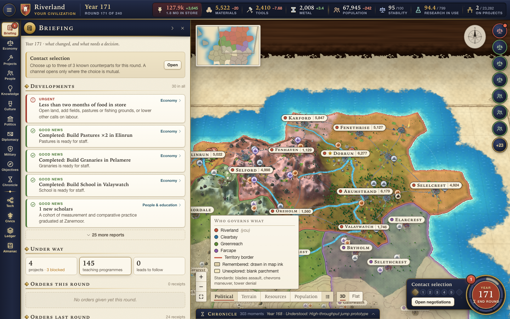
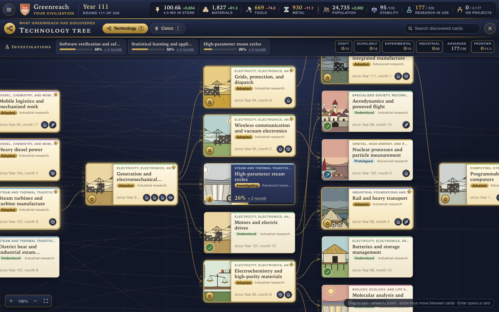
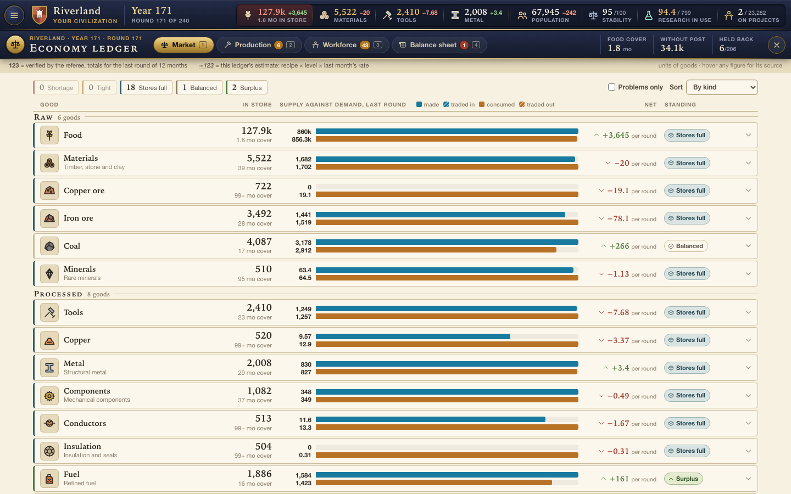
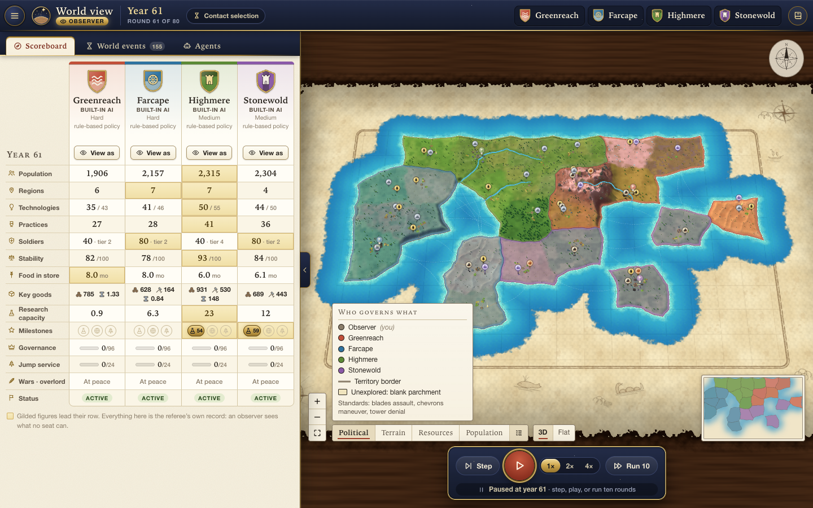
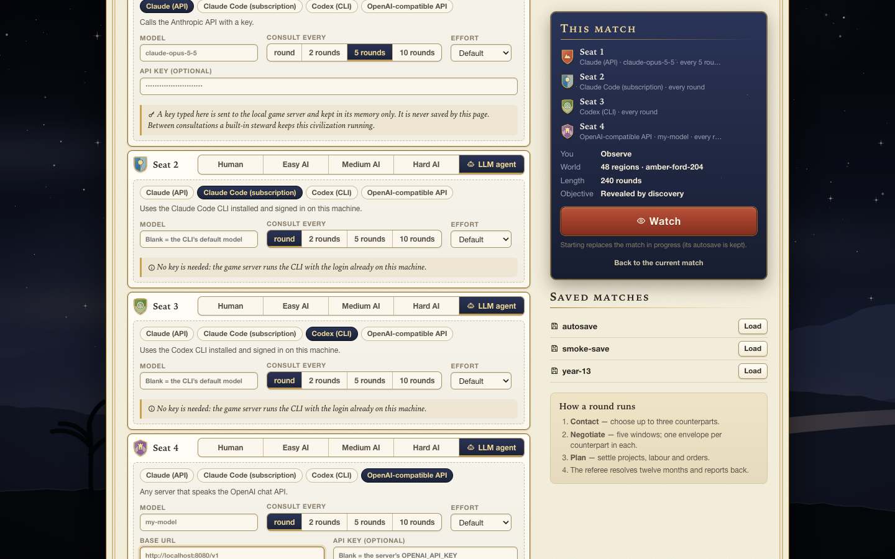
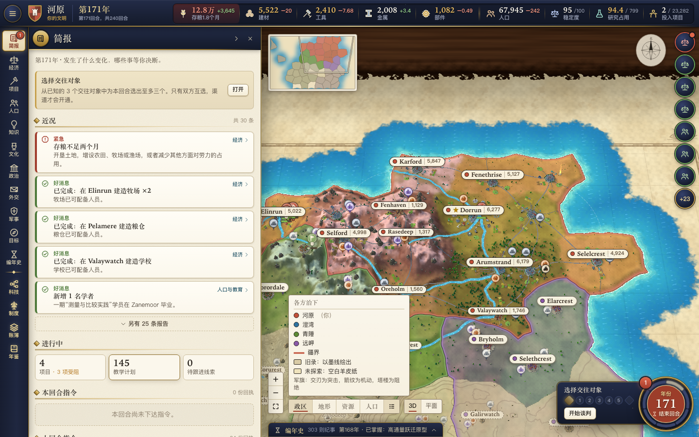

# Before the Stars

A competitive civilization strategy game for humans and AI agents. Four civilizations
grow from primitive, non-religious camps toward sustained faster-than-light capability
while managing the interdependence of food, labour, education, production, knowledge,
culture, diplomacy and war. One seat at most can win, and winning takes **both** real
governance of the whole inhabited world **and** a jump-capable service the winner can
build, crew, supply and replace.

This repository contains the v1.0 design documentation (`docs/`) and a playable
implementation of it: an authoritative Rust rules engine with native non-LLM opponents
and optional language-model seats, and a desktop application for macOS and Windows
(the same client also runs in a browser, and as a static site with the engine compiled
to WebAssembly).



| Title screen | Technology tree | Economy ledger |
| --- | --- | --- |
|  |  |  |

| Observer console | Match setup | 简体中文 |
| --- | --- | --- |
|  |  |  |

## Play

### As an installed game

Packaged builds open the game in its own window, with nothing else to install:

- **macOS** (Apple silicon and Intel): `Before-the-Stars-<version>-macos.dmg` — drag the
  app to Applications and open it.
- **Windows 10/11 x64**: `Before-the-Stars-<version>-windows-x64.zip` (portable) or the
  `-setup.exe` installer.

Build them yourself with `scripts/package.sh` (output in `dist/release/`), or let the
`release` GitHub workflow build them on native runners when you push a `v*` tag. The
builds are not code-signed: macOS asks for right-click → Open the first time, and
Windows SmartScreen asks for "More info → Run anyway". Signing needs your own Apple
Developer ID and Windows certificate. See [docs/packaging.md](docs/packaging.md).

### From the repository

Requirements: macOS or Linux with `bash`, `curl` and `git`. Everything else is
installed **inside this repository** (`.toolchain/`), nothing globally.

```bash
scripts/bootstrap.sh     # once: Rust + Node.js into .toolchain/, web packages
scripts/run.sh           # builds if needed, then serves the game for a browser
target/release/bts       # or: the same game in its own window
```

`scripts/run.sh` serves <http://127.0.0.1:7878/> for development and for external
agents. The match autosaves each round and resumes on restart (`--fresh` ignores the
autosave).

### In a browser, with no server

`scripts/build-pages.sh` builds the game as a static site (`dist/pages`): the rules
engine and the built-in opponents run as WebAssembly in a Web Worker, so nothing is
installed and no referee is running. `.github/workflows/pages.yml` publishes it to
GitHub Pages on every push to `main`. It plays human and AI-only (observer) matches,
autosaves in the browser and comes back after a reload; language-model seats and
external agents need the desktop or server game. See
[docs/web-build.md](docs/web-build.md).

A game can be exported to a `.btsave` file and imported again in any of the three
(desktop, server, browser): see [docs/saves.md](docs/saves.md).

### Seats, observers and languages

Each of the four seats can be a human, a built-in opponent (Easy / Medium / Hard), or
a language-model agent: Claude over the API, the local Claude Code or Codex
command-line tools using their own logins, or any OpenAI-compatible endpoint. Choose **Observer mode** on the title screen to set up an AI-only match. With no
human seat you are an **observer**: you see the whole world, a scoreboard, every
civilization's own view and each model's stated reasoning, and you control playback.
The interface is available in English, 简体中文 and 繁體中文, switchable on the title
screen. A guided tutorial and an in-game almanac explain the systems.

Language-model seats need something to talk to: an Anthropic or OpenAI-compatible API
key (typed at setup and held in memory only, or taken from `ANTHROPIC_API_KEY` /
`OPENAI_API_KEY`), or a logged-in `claude` or `codex` command on this machine. A seat
whose model cannot be reached reports the error in the observer console and stops
after three consecutive failures; the match continues without it.

### The screen

- **Map.** A 3D diorama of the known world (terrain, rivers, vegetation, settlements
  that change with the era, districts, resource badges, borders, armies) with
  political, terrain, resource and population lenses and a minimap. Land nobody of
  yours has seen is blank parchment. A flat atlas is one click away and is used
  automatically where WebGL is unavailable.
- **Technology and civics trees** (`T`, `C`). They show only what your civilization
  has discovered: the tree grows as leads are followed, and nothing undiscovered is
  drawn, named or counted.
- **Regional construction** (Economy). Choose a region, build or expand real installations, and inspect queued levels, input costs, staffing and operating bottlenecks. Maintained industrial levels share general support posts, capped at 20%; this does not multiply goods or waive skilled staffing. The map’s Construction lens shows development by large region.
- **Economy ledger** (`L`). Market balance per good, production by facility and
  region, production chains, workforce and a balance sheet. Figures the referee
  reported are marked apart from the ledger's own estimates.
- **Chronicle** (`H`), **almanac** (`?`), and panels for people, knowledge, culture,
  politics, diplomacy, military and objectives.

### A round

Each round is twelve simulated months for everybody. You read what changed, optionally
negotiate, plan, and end the round; the world then settles month by month.

1. **Contact** – privately pick up to three counterparts. A channel opens only where the
   choice is mutual.
2. **Negotiate** – five simultaneous windows; one envelope per counterpart per window and
   ten per pair per round. Messages are claims; only a signed structured treaty binds.
3. **Plan** – projects, programmes, policies, orders. Planning never advances time.
4. **Resolve** – twelve monthly steps of deliveries, labour, production, projects,
   teaching, food and water, births and deaths, conflict, discovery and culture.

"End round" passes every remaining phase. You are never required to negotiate.

### What you manage

- **Food and labour.** People eat first. Of the labour left over, custom lets you call up
  only a share for public projects; institutions raise that share. The rest staffs
  facilities in the order of your category weights. One person works one job.
- **Facilities and recipes.** Inputs are read from stock at the start of a month and
  outputs arrive the next month. Output is bounded by staff, qualified staff, inputs,
  power, upkeep and storage; every facility reports what is holding it back.
- **Education.** Twenty-four courses turn real learners into qualified people over real
  months, with teachers, places and materials. Students do not work. A first cohort can
  teach itself slowly when no instructor exists yet.
- **Knowledge.** The complete technology graph (138 nodes) is the same in every match;
  what you see is only what your people have discovered. Practice and contact produce
  leads; a small study turns a lead into a question; funded investigation with qualified
  staff turns it into understanding; building and operating turns it into capability.
- **Culture.** Sixty-four practices are recognized by people living with what they build
  on, enacted by reform once their real requirements exist, and then adopted gradually.
  Tendencies of each lineage drift slowly with how people actually live. A religion may
  emerge, or not; a secular path is fully viable.
- **Diplomacy.** Goods, teaching, maps, non-aggression, defensive pacts, peace,
  subordination and cession, as structured treaties with recorded performance.
- **War.** Three mutually countering roles per equipment tier; power is people × 2.5^tier
  × proficiency × supply × morale. No dice. Capture takes five months of control and
  sovereignty six more; occupied people do not become loyal workers.
- **The endgame.** Revealed only when your civilization discovers it (or from the start if
  you choose "disclosed objective" at setup): 96 continuous months as the highest real
  authority over every inhabited region with food, water and order holding everywhere; 24
  continuous months of fleet-wide jump capability; and two loaded round trips at least
  twelve months apart, flown during that governance. The winner scores `2 − T/H`;
  everyone else scores `−1`. Reaching the horizon with no winner is a valid outcome.

The chronicle records what your civilization actually experienced as an illustrated
timeline. Its cards grant nothing.

If you would rather not run everything yourself, hand any of economy, research,
education, culture, expansion or military to a **steward**. A steward is the same
non-LLM policy the native opponents use, limited to those domains and to what your
own seat can see; it acts once at the end of each planning phase and you can take a
domain back at any time. Diplomacy always stays with you.

## Headless play, evaluation and agents

```bash
source scripts/env.sh
cargo build --release

target/release/bts run --seed riverland --ai hard,medium,medium,easy --every 20   # AI-only match
target/release/bts run --seed eval --matches 8 --rounds 240                        # 8 matches in parallel
target/release/bts verify --rounds 40      # determinism and checkpoint recovery
target/release/bts inspect --seat 1 --rounds 120   # one seat's own view, for tuning
cargo test --release                       # release-gate properties
```

The browser client has its own end-to-end check. With a referee running on port 7979
(`scripts/run.sh --port 7979 --fresh`):

```bash
cd apps/web
npx playwright install chromium      # once; the browser is stored under .toolchain/
node scripts/smoke.mjs               # plays through every panel and flow, fails on any page error
node scripts/lategame-shots.mjs      # 170 delegated rounds against the AI, then screenshots
```

The browser build is checked with no referee at all (see [docs/web-build.md](docs/web-build.md)):

```bash
scripts/build-pages.sh
node apps/web/scripts/serve-static.mjs dist/pages 8080 /Before-the-stars/ &
node apps/web/scripts/pages-smoke.mjs http://127.0.0.1:8080/Before-the-stars/
```

External agents (Claude Code, Codex, scripts) play through the same HTTP API as the
browser, through the `bts observe | act | ready` commands, or the integrated
`get_turn` / `submit_turn` stdio MCP adapter (`node tools/mcp.mjs`). They receive only their
seat's observation. See [docs/agent-api.md](docs/agent-api.md).

## Repository layout

```text
crates/bts-protocol   Seat-facing contracts: Observation, Action, Receipt (serde)
crates/bts-engine     Authoritative rules: content, world generation, monthly simulation,
                      actions, observation projection, victory, tests
crates/bts-ai         Native Easy/Medium/Hard opponents; depends only on bts-protocol
crates/bts-host       The match host: session, request router and every permission rule,
                      shared by the server and the browser build
crates/bts-server     `bts` binary: desktop window, HTTP referee, language-model seats,
                      headless runner, agent CLI
crates/bts-wasm       The host as a WebAssembly module (plain C ABI) for the browser build
apps/web              TypeScript + Preact client: 3D and flat maps, trees, ledger, panels,
                      tutorial, observer console, translations; the Web Worker that runs
                      the WebAssembly referee
content/              Technology, practice and course graphs extracted from the design atlases
content/lore/         Encyclopedia passages for every technology and practice, keyed by content
                      id: { id, en, zh-Hans, zh-Hant } each with an intro and an optional
                      quote. Client-only (the engine never reads it); zh-Hant is generated
                      from zh-Hans by apps/web/scripts/make-zh-hant.mjs, and
                      apps/web/scripts/lore-check.mjs checks coverage, lengths and that no
                      passage names a node that is not among its ancestors. Entries for
                      designed but unmerged nodes (docs 37 and 39) already live here and are
                      checked against the draft graph; the client ignores ids not in content/
scripts/              bootstrap, build, run, package, browser build, content extraction
packaging/            app icon, macOS bundle metadata, Windows installer script
docs/                 v1.0 design documentation, agent API, implementation status
dist/                 The original design archive and its checksum
```

The engine is integer-only and deterministic: the same seed and the same actions give
the same state hash, and a restored checkpoint continues identically. The native AI is a
separate crate that cannot see the engine's state; it is called with its seat's
observation exactly as an external agent would be.

## Implementation status

This is a complete playable loop built to the v1.0 design, with deliberate
simplifications. [docs/implementation-status.md](docs/implementation-status.md) lists,
chapter by chapter, what is implemented, what is abstracted and what is not yet built.
In short:

- Implemented: seeded causal geography; aggregate population with 81 annual age cells,
  nine-month birth lag and one combined mortality calculation; labour, power, recipes,
  upkeep and storage; all 138 technologies, 64 practices and 24 courses with dynamic
  discovery; religion founding; structured treaties with the contact / window / envelope
  limits; three-role warfare, occupation and elimination; G96 ∧ F24 ∧ Trials96 with
  terminal reward; seat-filtered observations with opaque handles; three native AI
  difficulties without information or resource bonuses; saves, replay hashes, HTTP and
  CLI agent access; observer mode and language-model seats; a desktop application with
  a 3D map, discovery-limited technology and civics trees, an economy ledger, a
  tutorial and almanac, a Historic Moments chronicle, and English, Simplified Chinese
  and Traditional Chinese throughout.
- Abstracted: goods are pooled nationally with a per-region carriage loss instead of
  per-shipment logistics; the 34 recipes are represented by about sixty facility types;
  private actors, prices and money are folded into labour, goods and callable-labour
  limits; factions are reported but act through stability rather than as separate
  ledgers; there is one access class per region.
- Verified by tests and scripts, not by a human playthrough to the end: the client has
  been driven by automated browser runs (every panel, hot-seat diplomacy, a late-game
  state against the AI), but wars, religion founding and the jump programme have not
  been played by hand.
- Not yet verified at all: language-model seats against a real model (only a scripted
  stand-in has been run end to end); the 3D map on a real graphics card (automated
  runs use software rendering, so frame rate is unmeasured); the Windows build (it
  compiles, it has never been started); the `release` workflow; the Chinese text by a
  native-speaking reviewer.
- Not built: multi-match server rooms, generated SDKs, and post-match
  counterfactual replay.

Numbers are provisional calibration, as the design states, tuned only through all-AI
matches. In those matches the stronger native opponents typically reach the scientific
method between year 45 and year 75 and complete the full technology and practice
graphs between year 160 and year 200. Once the final objective is revealed they fight:
the leader usually conquers or subordinates one or two rivals and can end holding most
of the world. No native opponent has yet completed 96 months of global governance
inside the 240-round horizon in the evaluation batches, so all-AI matches almost always
end unresolved, which the design treats as a legitimate outcome. The complete-victory
rules themselves are covered by tests.

## Design documentation

Start with [docs/README.md](docs/README.md) and
[the complete v1.0 plan](docs/design/30-complete-plan-v1.0.md). The design documents are
designer material: they describe hidden mechanisms and the eventual objective. Runtime
isolation hides match state from seats; it does not make a published design unknowable.
