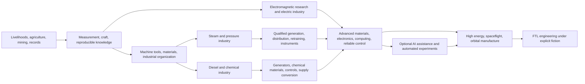

# 0.6 — Dynamic Development, Technical Transitions, and Cultural/Educational Evolution

This revision develops design only. Complete catalogs are the [technology atlas](17-technology-atlas-v0.6.md), [cultural practices](18-cultural-atlas-v0.6.md), and [education/transmission](19-education-and-transmission-v0.6.md). This document defines how one fixed graph produces different knowledge, implementation, and adoption paths under different worlds. Complete graphs and causal mechanisms are designer/referee material, excluded from seat packages.

The subsequent [0.7 industrial specification](23-industrial-development-v0.7.md) adds recipes, six strata, paired-condition comparisons, and prerequisite corrections. [31](31-knowledge-and-culture-v1.0.md) supplies v1.0 discovery/presentation corrections; [32](32-population-and-education-v1.0.md) replaces excessively detailed demographic and continuous-readiness processing with sparse cohorts and scheduled review. The 403 technology references reported below are a historical v0.6 review snapshot, not a current verification claim; recount the current atlas after revisions.

Rules inherit 0.5's eight monthly phases, actual inputs, slow culture, limited information, and deterministic multicore execution. [15](15-victory-and-ftl.md) governs global integration and fleet acceptance. This catalog defines complete candidate structures/behavior, not every material recipe, cost, and initial state required for executable content. In v1.0, every mode is competitive and common institutions never create shared victory.

## Scientific boundaries and references

Steam, diesel, and electricity can coexist as industrial traditions. Cyber society combines technology, ownership, and life arrangements; AI rule combines computing with actual delegated governance. They are not five exclusive classes each reaching a different magical FTL. Steam/diesel accumulation must transition into electrical measurement, materials, computing/control, and spaceflight.

Civilization VI organizes technologies and civics as research graphs, with culture granting policies/governments. This game borrows readability and substitutes concrete evidence, engineering, and population adoption. [Official manual](https://downloads.2kgames.com/civilization/vi/manuals/eu/CIV_VI_25TH_ONLINE_MANUAL_ENG.pdf)

Civilization VI already offers a technology/civic shuffle mode that changes within-era prerequisites/costs and hides unrevealed nodes. This game keeps a fixed complete graph, using scientifically constrained alternative processes, real production, distributed knowledge, local practice, and costly conversion instead of shuffled dependencies. [Official August 2020 update](https://store.steampowered.com/news/posts/?appids=353370%2C289070&enddate=1602601207)

FTL is an explicit fiction required by the victory premise. A mathematical construction in general relativity is not a buildable engine; the Alcubierre paper, for example, requires special matter conditions. Steam, high magnetic fields, AI, and quantum entanglement are not claimed to establish FTL through proven science. [Original paper](https://arxiv.org/abs/gr-qc/0009013), [NASA explanation](https://science.gsfc.nasa.gov/attic/cosmicopia.gsfc.nasa.gov/qa_sp_sl.html)

Content distinguishes established principles/processes, scientifically grounded but unverified scale/performance extrapolations, and explicit fiction. Futuristic names do not waive energy, heat rejection, material, manufacture, measurement, or control constraints. Beyond the FTL assumption, there is no perpetual motion, infinite pressure-computing, instant knowledge infusion, or free consciousness copying.

## Complete graph, world conditions, and two kinds of change

| Object | Content | Who changes it |
| --- | --- | --- |
| Fixed complete content | Nodes, AND/OR dependencies, discovery/unlock rules, practice conditions, courses, scientific/FTL assumptions | Developers through a new content_version only; identical within a version |
| Match world and implementation | Geography, quality, ecology, initial population/organizations, later facilities/skills/supply/demand; evaluates applicability against the fixed graph | Seeded initial state, then actual processes; not another editable root graph |
| Each subject's knowledge | Encountered clues, questions, evidence, explanations, prototypes, adoption history | That subject's observation, experiments, teaching, records |
| Actual capability/practice network | Who knows what, where it can operate, who joins which institution | Production, learning, adoption, exit, damage, population flows |

Dynamic development includes expanding cognition and changing real capabilities/social practice. Generation and runtime cannot remove nodes or OR options. Undiscovered, unadopted, temporarily uneconomic, and collapsed in the current UI are four different conditions, none changing the complete graph.

Technical prerequisite columns concern knowledge; construction conditions are separate. Understanding cannot replace operating equipment, and imports do not automatically teach local manufacture. Cultural cognitive parents concern understanding a method; adoption still requires institutions, people, lawful rights, and resources. Discussion without successful execution is possible.

## Different paths from one graph

1. Load/verify identical complete technology/culture graph and rule hashes. Science/FTL, courses, practices, discovery entries, and AND/OR combinations are authored content, not generation samples.
2. Seed geography, reserves, quality, ecology, transport, population, and organization. Physical/adaptation functions remain fixed. A batch can make a process locally unusable without deleting it or changing prerequisites.
3. Retain every defined material, equipment, and process arrangement. Players invest from known information; actual supplies, facilities, and people determine cost/feasibility. Unchosen alternatives remain obtainable through later discovery, trade, construction, and training.
4. Decompose large projects through fixed templates. The UI may group known content; the referee may lazy-load templates. Display groups, caches, and project instances cannot create/merge/delete graph nodes or omit inputs, evidence, training, or time.
5. Fixed discovery rules read real production problems, observations, and contact to produce distinct local signals. Validate every essential direction's discovery entry in content; do not patch defects with seed-specific new entries.
6. Every major tradition has bridges to shared advanced engineering and at least two differently structured FTL arrangements. Check each initial civilization for a structural route independent of a specific rival's voluntary cooperation. Regenerate invalid worlds, not recipes or edges.
7. Content validation checks cycles, interfaces, and discovery; world validation checks startup inputs, first teachers, and economic conditions. Graph reachability is insufficient: frozen recipes must establish affordability. Reject defective fixed rules rather than secretly replacing edges.
8. Seal graph hashes, initial world, and random-stream commitments. Private-state commitments use salt. Players receive random handles and currently sourced content, not tier-revealing IDs. Complete graph/rules match across seeds; world hashes and observations need not.

An uncached or collapsed node can still produce a valid experimental clue through its fixed rules. The backend loads existing definitions and creates task/observation records, not nodes or new randomness. Once one civilization demonstrates a general process, others can learn through actual exchange without drawing their own matching card. Research changes knowledge state; trial error and material differences cannot rewrite the graph.

Match variation primarily changes local startup ease, which process is economical with existing inputs, and which problems first produce signals. Material quality and adaptation have shared world truth, not inexplicable civilization-specific research luck.

## Five sequential branching tests

| Test | Engine inputs | Failure or insufficiency |
| --- | --- | --- |
| Can a clue arise? | Actual work, observation, contact, recording | No signal; browsing the UI is not free discovery |
| Can the problem be understood? | Encountered evidence, expression/quantity skills, explanations, checking | A clue without an executable plan; train, investigate, or import |
| Can it be prototyped? | Qualified people, materials, instrument slots, energy, facilities | Known problem waits for complements; money is not progress |
| Can it scale? | Demand, equipment, supply, maintenance, rights, workers | Successful prototype but stalled industry; knowledge survives |
| Deepen or convert? | Known returns/risks, existing assets, conversion plan, opponent information | Player and bounded private decisions, no hidden best-route switch |

Returns affect investment and prestige without revealing correct answers. Profitable industries can absorb people needed by long-horizon research; powerful groups can defend old standards and license income. Conversely, actual procurement, education, and risk sharing can build future capability despite poor current prices. Models must judge evidence and time horizons.

Steam tradition, diesel network, electric industry, and cyber society are historical/panel summaries derived from operating equipment, services, jobs, property, and practices. They give no extra bonuses or unlock conditions. Labels overlap; renaming a state changes no capability. Actual supply/demand determine costs without a hidden domestic-steam discount.

## Leaving middle-stage traditions

This illustrates transitions, omitting actual AND prerequisites; use 17 for complete dependencies. Not every industry must convert simultaneously. Thermal cycles can still generate power; diesel can serve transport/backup. Advanced capabilities do not mandate scrapping useful old assets.

| Existing tradition | Transferable accumulation | Missing capabilities | Actual conversion costs |
| --- | --- | --- | --- |
| Steam/central machinery | Pressure vessels, precision work, heat, rail, engineering organization | Generation/distribution, insulation, measurement, electronics/computing, new materials | Refits, downtime, conductors/complements, retraining, old leases/interests |
| Diesel/distributed combustion | Engines, mobile logistics, fuel quality, chemical materials | Reliable grids/local power, precision electronics, controls, high-energy materials | Network/equipment repurposing, fuel dependence, repair and skill conversion |
| Electric/networked industry | Generation, motors, electrochemistry, remote coordination, instruments | Finer manufacture, reliable computation, thermal protection, space tests | Grid reliability, material quality, replacement, systemic failure |
| Networked cyber society | Communication, software, sensors, automation, data organization | Physical industry, energy, scientific checking, life support, common governance | Platform/data rights, concentrated failures, displacement/retraining, bargaining |
| High-autonomy AI governance | Scheduling, records, automated experiments, executable delegation | Bounded validation, dissent/correction, manufacture/maintenance, lawful responsibility | Continuing compute/energy, correlated errors, authority disputes, declining human fallback skills |

Conversion consists of equipment assessment → reusable parts/recovery → refit/new construction → bridge courses → parallel operation/validation → gradual withdrawal. Recovery refunds neither historical wages nor fuel. Courses credit only actually demonstrated equivalent tasks. Parallel operation requires maintaining both systems, not retaining every option for free.

Scientific coherence does not require reproducing one historical sequence. Water power plus electrical knowledge can reduce steam investment; rich fuel supplies can support earlier mobile power. Machine tools, materials, and controls remain necessary. Routes need not be equally fast; advantages should be conditional and exit should not be blocked by identity.

## Culture: experience, interpretation, practice, transmission

Keep eight private 0–10000 axes: openness, revisability, exploration, agricultural stewardship, industrial workmanship, urban organization, exchange, and martial obligation. They are independent, not a point allocation. Rights, doctrine, skills, and institutional wealth remain separate, with no ninth advancement score.

The direction labels in 18 are initial authored relationships. Unlisted axes are zero; signed components normalize by total absolute magnitude. Zero-direction practices directly update no axis. These relationships describe possible learning from experience, not attributes awarded on adoption. Organizations, teachers, and media cannot edit vectors arbitrarily; they transmit real practices and interpretations through actual contact.

For group g, actual event e, and axis d, construct monthly signals using 16's bounds and anti-farming rules:

1. Use encountered outcomes and prior expectations. Normalize livelihood security, bodily safety, services, performance, and other relevant metrics using fixed positive references to −1…1, combining only genuinely related metrics into bounded z. No omniscient policy outcomes or unknown suffering of others.
2. Event identity comes from actual process and recipient lineage. Preserve first exposure, coverage, new evidence, and existing interpretation. Replays reach new recipients but cannot refresh old samples, decay, or shock allowances.
3. Update credibility r only from received, checkable records. Sealed priors are identical by source type. Baseline `r=(a+s)/(a+b+s+f)`, with a/b>0 and s/f independently deduplicated, locally checked matches/mismatches. Unresolved disputes count as neither. Retelling the same source adds no independent sample; renaming/splitting outlets or controlled relays cannot reset source lineage. This is a game trust model, not a true correctness probability.
4. Effective w reflects exposed affected population share, credibility, net magnitude, and decay. Each axis includes nonzero-direction evidence only: `s(d)=Σ(w×z×v(d))/Σw`, W=Σw. Wref scales consistently with source population; splitting cannot improve `q=min(1,W/Wref)`.
5. With evidence, calculate `raw_target=clamp(anchor+5000×s,0,10000)`, `gap=raw_target−current`. Positive s uses `directed_gap=max(0,gap)`; negative s uses `min(0,gap)`; zero uses 0. Then `target=current+q×directed_gap`. Positive evidence cannot lower the existing value, nor negative raise it. With none, preserve current. Ordinary updates cannot repeatedly reset anchor through profile versioning.
6. Move toward target using monthly λ≤0.002 ordinarily or ≤0.006 during crisis. Rolling 12-month absolute drift per axis is capped at 150/500 respectively; accelerated crises last at most 12 consecutive months. Trait entry/exit needs at least 36/60 months of evidence; memory remains 120 months with 36-month half-life.

One successful process can yield different consequences: benefiting merchants may reinforce exchange while uncompensated families become less willing to travel. Attribution can be wrong; education supplies tools/contact, not guaranteed explanations. Credibility changes whose claims are accepted without leaking referee truth to people or players.

Actual care, classes, apprenticeships, and peers transmit culture. Weights follow completed intelligible contact hours; no teaching capacity means no transmission. New populations inherit anchors from actual care sources—aggregate cohorts under v1.0—while existing people's courses affect current. Normalize shared home/school/work contact first; three systems cannot each claim 100% transmission.

Actual adoption separately uses bounded choices/capacity matching: known candidates → willing or obligated participants → real places/hours → trial → sustained operation. Recognition does not guarantee consent; obedience does not guarantee belief; migration changes shares without instantly converting incumbents. Compatible practices coexist; incompatible offices/time use one ledger.

## Education through development

Use four-domain ability distributions and task qualifications, reporting coverage, depth, teaching quality, practice, and application. Lack of formal writing does not mean ancient populations lack complex skills. A few scholars do not imply mass coverage.

Knowledge bounds content, economic capacity bounds enrollment, practice establishes mastery, and jobs/institutions determine use. These jointly constrain early societies without an arbitrary “before year X literacy is at most 5%” cap. Real textbooks, teachers, surplus, supplies, and released learner time can expand basic education early, never teach nonexistent modern subjects.

19 defines course hours, effective months, practice inputs, qualifications, and historical review rules; 32 supplies v1.0 event-driven authorization. Practitioners begin early teaching. Actual research/replication creates first advanced teachers without preexisting graduates. Maximum finance can still encounter teachers, equipment, or jobs as bottlenecks.

AI may reduce explanation, feedback, and translation costs with validated content, hardware, inference energy, and supervision. Physical operations still need practice. Validate assistant-dependent and offline-independent ability separately; an assistant answering correctly does not qualify its operator. A server shutdown does not erase learned skills, but missing human substitutes do not appear.

## Culture for interstellar preparation

There is no final interstellar-civilization bonus node. Remote/orbital engineering introduces real tensions: duties outlast officeholders; travel/communication are delayed; life-support failure affects many; projects cross organizations, languages, and generations; intelligent systems may execute while liability still needs an owner.

| Problem | Alternative institutions | Verified outcome |
| --- | --- | --- |
| Long investment and responsibility | Long public budgets, contractual funds, professional engineering bodies, bounded mission organizations | Assets and maintenance survive terms/succession |
| Delay and local discretion | Federal delegation, mission command, autonomous operating contracts | Preauthorized action when disconnected, later records/liability review |
| Mistakes and correlated failure | External review, independent internal inspection, peer checks, heterogeneous models, human reserves | Real people/equipment/power detect and correct, not a transparency label |
| Multiple populations | Common citizenship, autonomy-preserving charters, enforceable multilateral duties | Actual participation/service, no required uniform religion/culture |
| High autonomy | Bounded assistance, delegated administration, actual highest AI governance, limits on machines | Real compute, data rights, liability, dispute handling, takeover |
| Remote people and future members | Crew/colony rights, long care/archives, possible nonhuman recognition plans | Clear maintenance/loss responsibility; no aliens created before encounter |

Professional bureaucracies, technical federations, contracted corporate networks, and AI-participating systems all pay real organizational costs. No regime name automatically satisfies integration, and no ideology is a scientific FTL prerequisite.

Highest AI governance is not another external model playing free. Seats and inference budgets remain unchanged; in-world authority, tasks, compute, and execution change. Renaming a ruler cannot refresh continuity. Actual highest control transferred to another polity triggers 15's audit. Capability does not prove consciousness; legal plans may anticipate recognition, but software copies create no people, votes, labor, or resources.

## Three pathway checks and cultural arithmetic

**River-basin coal and iron.** Stable food surplus, coal/iron, and transport make steam drainage, tools, and rail plausible investments. Contractors/craftspeople benefit. When instruments and grids become useful, government can retain steam and add generators/measurement, retraining batches. Protecting old standards can block actual project acceptance; neither a steam-era ceiling nor a steam spacetime device appears.

**Fuel transport network.** Liquid fuel and dispersed demand support engines, repair stations, and chemistry without prior centralization. Electronic controls, refining, and orbital engineering need new power/staff networks. On interruption, reserves, licensed alternatives, and local capacity change options. Oil owners' interests do not directly become universal hostility to science.

**Hydropower and ports.** Water, conductors, instruments, and trade can support earlier electricity with fewer centralized steam plants. Machine tools, insulation, measurement, materials, and processes must still be made or actually imported. Different cyber institutions can emerge from networks/platforms; chips alone do not trigger AI rule.

**Slow cultural change.** A port group has exchange current=4000, anchor=4000. Independently verified contract performance gives s=0.8 and W/Wref=0.25. raw_target=8000, target=5000. With λ=0.002, change is only 2, reaching 4002. Reposting does not raise W or refresh age. Wider actual exposure, sustained performance, and better conditions for harmed groups can build evidence monthly, still within annual limits. One campaign cannot create a trading people.

**Existing tendencies and weaker evidence.** With anchor=4000,current=7000,s=0.2, raw_target=5000. Positive-direction clipping gives directed_gap=0 and preserves 7000. Weak positive experience cannot cause decline or additional reward. Genuinely negative signals may slowly lower current; no evidence does not automatically return people to birth profiles. Evidence can still offset or be misattributed; clipping prevents mathematical reversal only.

These are mechanism checks, not historical reenactments or executed results. Identical geography permits different decisions; it constrains costs/feasibility, not one cultural endpoint.

## Obvious prescriptions and exploits to avoid

- Always research: discovery/theory cannot replace teachers, equipment, scale, maintenance, governance.
- Always educate: content depth, graduation delays, practice, and jobs limit returns; idle budgets do not vanish.
- Always open: cooperation needs review, compensation, supply assurance, absorption; closure still sacrifices knowledge/trade.
- Always buy the newest equipment: account for demand, depreciation, conversion downtime, complements; old assets can remain useful.
- Always choose AI rule: correlated errors, data rights, costs, missing correction persist; reliable authority/support produce benefits.
- Touch every branch: experiments, teaching, and reform consume unique resources; tiny studies give limited evidence, not a free complete graph.
- Create disaster then publicize relief: preserve net effects, responsibility, recipient lineage, fixed shock windows, evidence strength; rebranding one harm does not mint multiple cultural gains.
- Remove rights then claim consent: separate enforcement, participation, survey statements; coercion is not universal willing adoption.

Some capabilities—measurement, reliable power, real verification—are ultimately necessary. Necessary capabilities do not imply one optimal strategy: location, order, ownership, cooperation, redundancy, and transition timing remain competitive decisions.

## Historical structural and local checks

The v0.6 review recorded 138 technologies with 403 prerequisite references and 64 practices with 171 references. It reported no duplicate IDs, missing references, or directed cycles, with structural expansion from initial nodes under AND/OR conditions. All technology references in 24 courses existed, and 10 local arithmetic checks covered teaching hours, equipment, partial practice, and single-month cultural change. These are historical review records; later revisions require a new count rather than inheriting those results.

In temporary offline graph copies, removing AI, cultivation, glass, weapon/aircraft applications separately and all four together retained a structural T167 path. These are non-adoption counterexamples, not permission for generation/runtime deletion. They do not make the capabilities valueless or waive food, chemistry, or transport; they check alternative routes are not accidentally removed by indirect prerequisites. Conversely, excluding any essential bridge among electromagnetism, quantum/condensed-matter foundations, electricity, semiconductors, reliable controls, optoelectronic metrology, computing, space materials, or orbital manufacture prevented T167 in that content. A steam label bypassed none.

The review closed four cross-system problems: ordinary orbital life support need not require high-closure ecology; initial FTL specialists train from validated prototype tasks without waiting for final fleet acceptance; partial practice reduced decay rather than repeatedly refreshing full readiness; cultural targets were clipped by evidence direction to prevent weak positive evidence reducing current tendencies. Practice masters/original projects can establish first teachers; courses do not require their own graduates.

A further 500 combinations of anchor/current, positive/negative/zero signal, and exposure checked the cultural formula: one-step bounds remained 0–10000, change did not oppose net evidence, zero evidence/signal preserved state, and positive-decline and negative-rise examples were corrected. This was formula-boundary checking only.

These historical dependency/local checks were not simulated civilization matches, economic feasibility, or strategy balance. T167 reachability does not satisfy global integration, deployment, or trial windows, nor establish real FTL science.

## Freeze status and remaining content work

17–19 enumerate nodes, cognitive prerequisites, capability requirements, practices, and courses. 20 defines world initialization, local discovery, and evolution on the fixed graph; 16 retains foundational state machines. Versioned graphs/rules match across seeds; IDs and node counts are not seat-queryable metrics. Scientific boundaries override earlier loose wording about arbitrary fantasy technology or unexplained cultural directions.

Before implementation, fill material recipes for every variant, local course-equipment specifications, cultural normalization/source priors, Wref, aggregate household/occupation behavior parameters, and whole-match scale. Version 1.0 uses 32's simplified population representation. Missing content cannot default to free, infinite, or successful. Dependency/task/local checks are possible now; full economic reachability, model win rates, and historical reproduction are not yet established.
