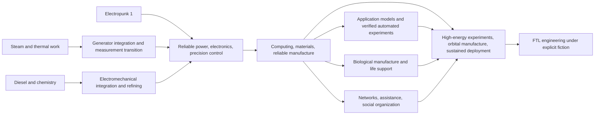

# 0.7 — Six Technology Families, Industrial Combinations, and Transition Acceptance

Later material appears in the [postindustrial overview](28-postindustrial-plan-v0.8.md), [AI/cyber/bio applications](25-ai-cyber-bio-industries-v0.8.md), and [four-civilization case](../reviews/07-postindustrial-campaign-v0.8.md). Complete graphs remain fixed within a version while real conditions change development emphasis and local visibility. These industrial semantics continue under v1.0, with [31](31-knowledge-and-culture-v1.0.md) and [32](32-population-and-education-v1.0.md) taking precedence for revised interfaces.

The requested AI, steampunk, dieselpunk, electropunk 1, cyberpunk, and biopunk become overlapping content strata. Electropunk 1 means the first electrical-industrial stage, followed by later stages—not a separate civilization type researched only once.

No hidden technology is added and no prerequisite in the [138-node atlas](17-technology-atlas-v0.6.md) is changed by classification. Strata organize existing knowledge, facilities, services, and qualified populations into readable industrial patterns. [Production chains](21-production-chains-v0.7.md) govern inputs/delivery, [education](19-education-and-transmission-v0.6.md) governs training, and [dynamic development](20-dynamic-development-v0.6.md) governs discovery/adoption/slow culture. All IDs and future strata are designer material.

## 1. Technical capability and social style differ

| Object | Facts stored | Direct effect? |
| --- | --- | --- |
| Technical knowledge | Understanding, evidence, prototypes, accessible records | Enables projects; no equipment means no output |
| Industrial capability | Location, actual equipment, qualified labor, inputs, upkeep, deliverable services | Actual operation supplies goods/services |
| Stratum summary | Which families/stages observed capabilities belong to | Display only, no bonus or hidden unlock gate |
| Social style | Historical description of assets, jobs, services, rights, participants | Specific institutions/behavior cause consequences, not the label |

Punk terminology can guide art, narrative, and authoring. Industrial societies need not call themselves steampunk, nor must networking cause extreme inequality. Technical possibilities, accepted institutions, and asset ownership are separate questions.

The six families are neither exclusive trees nor six fixed eras. One state can combine steam heat, diesel frontier freight, electric cities, AI laboratories, biological rural manufacture, and differently governed data networks. All share one land/material/energy/people/budget/transport ledger. Overlapping classifications do not duplicate capacity.

## 2. Eighteen capability strata

S/D/E/A/C/B are author classifications, not currency, extra nodes, or enumerable seat IDs. T references identify related content; 17 retains complete prerequisites. Several applications in a row do not require constructing all before using any.

### Steampunk: mechanical organization, thermal depth, electric bridges

| Stratum | Related nodes | Actual capability | Resources and specialists | Bottlenecks and transition |
| --- | --- | --- | --- | --- |
| S1 Practical mechanical steam | T060,T061,T063,T080,T082 | Boilers, reciprocating machinery, mine drainage, fixed shafts; steady work where heat/water exist | Qualified structures, fuel, water, seals; boiler crews, machinists, pump upkeep, safety | Fuel/water logistics, low-load idleness, shaft distance; retain tools/skills for S2 or electric bridges |
| S2 High-pressure and concentrated thermal industry | T067,T068,T081,T083,T084,T085 | Compound engines, turbines, rail, district heat; recovery only with actual heat demand | Quality steel, blades, pipes, insulation, treated water; proof tests, inspectors, thermal maintenance/dispatch | Fixed capital, correlated shutdowns, pipes, seasonal demand; turbines drive generators, heat networks accept new sources |
| S3 Thermal-electric and multi-source integration | T086,T087 and applicable T100,T102,T105 | Advanced cycles, coupled generation, thermal storage, multiple heat sources; already electrical/material industry | Hot components, clean water, storage media, monitoring/control; thermal plus electrical/metrology teams | Dual upkeep, conversion downtime, storage losses, interfaces; part of high-energy industry, not a steam spacetime engine |

S1→S2 does not mandate ever larger plants. Low-load rural shops may retain small units; dense cities/mines more readily sustain centralized demand. Benefits arise from fuel, skills, and orders, not a national steam-culture multiplier.

### Dieselpunk: fuel chains, mobility, distributed industry

| Stratum | Related nodes | Actual capability | Resources and specialists | Bottlenecks and transition |
| --- | --- | --- | --- | --- |
| D1 Refining and general combustion | T064,T066,T090,T091 | Qualified fuel, engines, local mobile/stationary power; refining and engine use separate | Feedstock, separators/reactors, lubrication/cooling; process operators, batch inspection, mechanics | Quality, refinery scale, stock, freight; crude cannot replace specified engine fuel |
| D2 Heavy transport and chemical networks | T092,T093,T094, T095 for relevant uses | Heavy engines, road/marine freight, mobile work, seals/insulation; civilian/military users share logistics | Precision injection, roads/ports, repair parts, chemicals; drivers, maintainers, process control, dispatch | Supply chains, wear, roads, emissions; expansion needs more valuable actual freight |
| D3 Diesel-electric integration and fuel substitutes | T096,T097 and applicable T100,T102,T103 | Generators, deployable industry, validated alternative fuels; combined power/chemical upgrading | Generators/controls, feedstock/catalysts, energy, checking; electromechanical repair, chemistry, energy accounting | Synthesis consumes energy/material; mobile factories use transport/local services; bridges to electronics, materials, space manufacture |

Fuel storage and mobility may retain value after electrification; vehicles need not all be destroyed. Conversely, owning oil does not make engines best for every load. Compare fuel, freight, repair, demand, and conversion capital.

### Electropunk 1 and beyond: power, control, advanced instruments

| Stratum | Related nodes | Actual capability | Resources and specialists | Bottlenecks and transition |
| --- | --- | --- | --- | --- |
| E1 Electropunk 1 / early electromechanical networks | T054,T100,T101; T102 when networked | Generation, motors, local light/power, early distribution; water/wind, qualified thermal or combustion input | Conductors, insulation, magnets, shaft input, lines/protection; motor builders, line crews, operators | Civil works, conductors, load location, variable supply, losses; electricity is conversion, not a source-free deposit |
| E2 Electrochemistry, electronics, reliable distribution | T102,T103,T104,T105,T106,T107 | Refining, storage, wireless/devices, power control; separate grades/scales | Pure feedstock, clean/vacuum processes, power, storage materials; electrochemistry, devices, instruments, reliability | Supply stability, yield, cooling, purity, upkeep, independent checks; batteries must charge, wire is not automatically a device |
| E3 Precision fields and high-energy interfaces | T108,T109 linked to applicable T143,T146,T148,T151 | Cryogenics, qualified superconductors, optical metrology, advanced control; supports space materials/high energy | Continuous power, refrigeration, optical/field components, shielding, precision; materials, cryogenics, optics, calibration, safety | Sensitive to continuity, disturbance, spares; shared advanced engineering still requires real tests |

Early electrification means prioritizing electrical supply/use after acquiring necessary knowledge and manufacture. Ancient people cannot skip gauges, materials, interchangeable parts, or electromagnetism. A national grid is not mandatory before one motor prototype; local and large-network supply are validated separately.

### AI: application models, experimental cooperation, high autonomy

| Stratum | Related nodes | Actual capability | Resources and specialists | Bottlenecks and transition |
| --- | --- | --- | --- | --- |
| A1 Application models and assistance | T110,T111,T113,T115,T116 | Train/evaluate/run scoped prediction, classification, generation, scheduling advice | Hardware, storage, power, cooling, data rights, independent validation; software, statistics, domain experts | Poorly matched data, inference, human review, upkeep; task validation, no generic research boost |
| A2 Specialist compute and automated experiments | T117,T118,T121 and actual T114 equipment | Clusters, instrument orchestration, engineering models, physically executed trials; more paid throughput | Chips/interconnects, power, samples, robots, calibration/upkeep; operators, experimenters, quality, researchers | Samples, scheduling, physical validation become constraints; failed trials still cost resources, retries are not new evidence |
| A3 Validated high-autonomy systems | Applicable T122,T123,T124,T125 | Sustained authorized planning/execution with identity, records, errors/takeover; extrapolations remain labeled | Redundant hardware, long services, traceable data, execution; audit, infrastructure, human fallback, domain responsibility | Correlated faults, concentrated authority, ongoing costs, fallback decay; highest power needs actual politics |

Training creates a model asset; inference supplies timed/location-bound service. Model-use rights do not grant training data or hardware manufacturing. Revocation separates acquired material from future service under contracts, never deletes learned knowledge. AI grants no extra external-player calls, people, or hidden world truth.

A3 does not mandate AI rule. C049 advisers, C050 bounded administration, C051 human reserves, and C053 highest authority are distinct choices requiring real permissions, provision, and duties. High autonomy does not establish machine consciousness.

### Cyberpunk foundations: networks, augmentation, infrastructure control

| Stratum | Related nodes | Actual capability | Resources and specialists | Bottlenecks and transition |
| --- | --- | --- | --- | --- |
| C1 Digital networks and traceable operation | T111,T112,T113,T115 | Communication, databases, validated software, networked trade/administration | Communication/storage, bandwidth, power, record rights; network/software/data/upkeep staff | Coverage, trustworthy data, access costs, interoperability; networks are not omniscience, latency/permissions persist |
| C2 Embedded automation and assistive augmentation | T114,T119,T121,T123; T116 where used | Automated workplaces, digital equipment models, verified medical aids, protected critical facilities | Sensors/actuators, fitted devices, medical support, real-time compute; engineering, medicine, software, independent tests | Coupling, maintenance compatibility, recovery, access; augmentation labels grant no unlimited strength/intelligence |
| C3 Network-dependent society and candidate neural interfaces | T120 extrapolation, T123,T124, actual dependent facilities | Closer interfaces and networked essential services; no presumed uploading | Clinical follow-up, individual fitting, terminals, data control, recovery; medical engineers, operations, liability, relief | Platform lock-in, data disputes, concentrated outage, distribution; corporate/common/mixed institutions possible |

These technologies also support public networks, cooperatives, and bounded markets. C048 corporate jurisdictions and C052 shared operation may use similar hardware with different control, finance, and distribution. Strata do not choose institutions. Inequality earns no research reward; a cyber label mandates no decadence.

Cyber and AI share computing/network/validation foundations. Databases, communication, identity, and automatic control do not require high-autonomy AI. AI laboratories need not first connect every resident to a private platform.

### Biopunk: manufacture, medical engineering, ecological habitats

| Stratum | Related nodes | Actual capability | Resources and specialists | Bottlenecks and transition |
| --- | --- | --- | --- | --- |
| B1 Biological measurement and controlled manufacture | Applicable T053,T070,T130,T131,T132 | Measure specific processes, clean manufacture, inspect specified foods/materials/medical products | Feed, nutrients/water, reactors, reagents, energy, clean conditions, waste; biology, chemistry, quality, care | Growth/processing duration, contamination, inspection, feed competition, demand; output only from actual recipes |
| B2 Biological design and medical engineering | T133,T134,T136 and applicable T119 | Data-assisted design, restoration, validated regenerative/assistive medicine; unvalidated ability stays research | Traceable samples/data, compute, experiments, medical inputs, follow-up; bio-data, research, clinical/ecological staff | Predictions need physical validation/long observation; medicine does not create immortality or infinite workers |
| B3 High-closure support and adaptive habitation | T135,T137 linked to T144/deployment | Reduced-resupply cycles, environmental control, difficult habitats; resupply/closure can mix | Structures, power, buffer stocks, sensors, replacement/isolation; ecology, life support, engineering, long upkeep | Losses, space, stability, recovery; no perpetual ecology or substitution for high-energy materials/orbital logistics |

Biotechnology changes feasible food, material, health, and habitation. It cannot bypass matter/energy or merge natural organisms, products, and political population. Birth, development, and qualifications retain population/education rules. Future regeneration, augmentation, and adaptive habitats grant only explicitly defined, actually verified capabilities.

## 3. Acceptance and loss of capability

Each application keeps four separate records, never a national era label.

| Record | Minimum evidence | Insufficient state |
| --- | --- | --- |
| Understanding/prototype | Explanation, real tests, conditions, failures | Theory/sample without industrial scale |
| Manufacture/import | Qualified local equipment, installation, commissioning, rights, maintenance records | Imported products may run without local manufacture or full document rights |
| Sustained delivery | Actual dated output/services, inputs, upkeep, quality, user tasks | Missing power/material/people reduces or stops service; history remains |
| Reproduction/recovery | Spares, replacements, drills, production or deliverable contracts | One success is not sustainable expansion; report actual external dependencies |

Sustained operation is not one universal national three-month threshold. Boilers, models, medicine, and life support have specific pressure tests, task coverage, batches, or observation periods. Panels describe actual scale/reliability; strata add no hidden rewards.

Missing maintenance can immediately reduce delivery. One shortage does not delete knowledge or revert everyone to an earlier era. Skill authorization follows specific tasks/practice/review, updated to event-driven states in v1.0. E2/A2 status never qualifies untrained people automatically.

## 4. How talent and culture affect branches

| Transition | Reusable talent | Remaining tasks | Real cultural/organizational conflict |
| --- | --- | --- | --- |
| Steam → electricity | Machining, gauges, pressure/material inspection, maintenance | Electromagnetism, insulation, wiring, protection, motors; E017 task gaps | Contractors fear lost orders, masters lost status; credible retraining/jobs can reduce resistance |
| Diesel → electricity/materials | Engine repair, chemistry, fuel quality, mobile dispatch | Power, controls, purity, new-material testing | Fuel/transport interests may favor new markets or obstruct substitutes; residents need not agree |
| Electricity → digital/AI | Electrical/instrument/equipment skills, engineering mathematics | Programming, data, statistical checking, specialized operations; E018/E019/E022 roles | Access to data/texts, wages, automation displacement, responsibility need bargaining |
| Digital → cyber applications | Networks, software, manufacture, records | Medical fitting, clinical follow-up, infrastructure recovery | Prices, faults, privacy losses differ among residents, producing distinct demands |
| Chemistry/digital → biology | Process control, cleanliness, quality, statistics, compute | Biological processes, samples, medical/ecological tasks, long verification; E020 specialties | Food/land/water/feed competition; treatment access and risk distribution change support |
| Multiple industries → orbital/pre-interstellar | Precision, electricity, software, chemistry, medicine, thermal work | Space environments, sustained deployment, support, distant maintenance; E023/specialties | Intergenerational finance, local authority, long provision, inherited liability |

Tendencies affect applicants, households able to sustain study, organizations allowing teaching, cooperation, and occupations—not a national research-speed coefficient. Education helps conversion while first teachers, equipment, and living support remain bottlenecks. Maximum classroom budgets do not guarantee graduates.

Steam masters and electrical teachers share one time ledger. Preparing lessons can reduce current repairs; full-time working students cannot also receive full learning hours. Funded provision and early stations cost money but may reduce later idle production. Subsequent culture follows 20's actual exposure, attribution, deduplication, and slow limits, not industrial-orientation points on approval.

## 5. Connections to shared advanced engineering

Steam, diesel, and early electrical investment each supply part of advanced industry, not independent complete endpoints.

Arrows show potential contributions/transitions, not changes to 17's prerequisites. AI, bodily augmentation, and high-closure ecology are optional for FTL. Software verification, reliable manufacture, actual energy, and ordinary life support remain necessary. Resupplied habitats and autonomous equipment can still support qualified deployment.

AI can aid design/scheduling; biology can reduce some supply burdens; networks can support cooperation. Compare each contribution with continuing inputs, alternatives, and staffing. [Victory rules](15-victory-and-ftl.md) separately audit integration and sustained fleet FTL; no top stratum directly wins.

## 6. Human and agent panels

Show only discovered, encountered, or locally verifiable content:

- Known problems, executable trials/construction, known inputs/staff/quotes/deadlines.
- Regional equipment, actual monthly output/service, stoppages, known vacancies, training; forecasts separated from actuals.
- Equipment, parts, data, models, and licenses with rights, terms, known dependencies.
- Learners, qualification domains, completed tasks, recent practice, eligible jobs; no private cultural axes or hidden proficiency.
- Sourced industrial history, such as concentrated steam workshops after growing coal freight or expanding motors with neglected lines, without future-stage lists.

Return no future stratum count, undiscovered T IDs, complete six-family progress bars, hidden next-tier requirements, or premature distance-to-FTL metrics. A player's imagined technology can only motivate an affordable study of known problems; validation cannot confirm whether a hidden node exists.

Humans may collapse known groups; agents receive identically authorized structured plans/accounts. Stratum names add no action. Actual choices remain investment, production, purchasing, licenses, research, education, institutions, diplomacy. Store designer summaries separately from match observations; client packages exclude full candidate strata.

## 7. Stratum exploits to prevent

| Attempt | Constraint |
| --- | --- |
| Count a turbine once as steam and again as electricity | Inputs, equipment-time, outputs have one real process origin; classifications reference it |
| Crossing a stratum upgrades every device/person free | Facility-specific projects and task qualifications; understanding, delivery, training separate |
| Study six labels for all route bonuses | No naming reward; actual trials/building/operation share budgets/equipment/hours |
| Electric choice skips fuel/mechanical input | Generation needs actual prime mover/energy/losses; water also needs sites, upkeep, construction |
| Self-copy AI expands workforce/external inference | Storage/transmission and execution require resources; no extra people or contestant tokens |
| Networking automatically creates AI rule/corporate state | Authority, property, responsibility, institutions separately established |
| Lossless biological loops create food/energy/people | Record inputs, outputs, losses, space, duration; product recipes create no political population |
| Rebrand old work as a new tier to reroll research/culture | Preserve task/asset/population/event provenance; names change no trial, learning, window |

This freezes classification/acceptance semantics, not returns or win rates. Complete content still needs product specifications, capacities, demand, inputs, staffing, and scenarios. Paired comparisons retain geography, population, culture, information, and external quotes, then compare consequences of choices.
