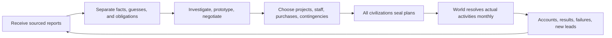

# 0.8: What a First-Time Player Actually Does

This complete designer-facing walkthrough contains late-game objectives. It is not an opening agent package. Imagine I lead Riverland without memory of previous matches or access to designer documents and hidden graphs. I retain ordinary scientific knowledge, but it cannot directly grant unverified local processes, resources, or rights.

**Historical status:** the original walkthrough uses the now-retired “Common Future” cooperative setting to illustrate a possible development path. v1.0 is exclusively competitive; the cooperative M336 outcome below is preserved as historical conditional engineering accounting, not a current mode or evidence that rivals surrender sovereignty. The final competitive section and [chapter 33](33-competition-and-native-ai-v1.0.md) define the current interpretation. The candidate standard clock is now fixed at 12 simulation months per round, H2880/240 rounds; the postindustrial dates below use the separate checkpoint clock of [campaign 07](../reviews/07-postindustrial-campaign-v0.8.md). This is no guaranteed opening or retrospective injection of future knowledge into turn one.

## I manage society's commitments and capabilities

I direct public assets, authorized projects, institutions, negotiation, and command. Families, villages, businesses, guilds, religious groups, and local institutions have their own property, knowledge, and choices. My budget produces results only when actual teachers, ore, workplaces, transport, and willing or lawfully directed people exist.

Technology changes what can be done; production and education determine who can do it now; culture and institutions affect participation, coordination, and costs. Diplomacy provides access to others' accumulated capacity while exposing me to interruption. Cities organize these relationships, connected to villages, mines, workshops, ports, and supply routes.

The complete technology and cultural-practice graphs are identical every match. I see a local graph unfolding through actual experience. Sustained steam industry reveals thermal, mechanical, and material problems sooner. Imported electrical equipment, mentors, and trials can reveal the already-existing electrical branch. A practice nobody currently accepts is obstructed in society, not deleted from the world graph.

Each round I address three to five important changes. This is not an action-point cap: I may issue more decisions, but actual inputs and capacity limit simultaneous execution. Contracts, maintenance, production, trade, and courses continue under sealed standing plans; I do not manually rebuy coal or resend teacher wages every month.

My real question is what constrains the next step, whether removing it exposes a costlier constraint, and what to prepare early. Building, importing equipment, buying rights, hiring mentors, and joint research have different costs. A valuable decision can transform decades of subsequent development, but no interface reveals an omniscient optimum.

## A round on screen or through agent tools

| View | What I evaluate |
| --- | --- |
| Map and settlements | Known communities, surveys, routes, actual control, unconfirmed reports |
| Supply and treasury | Goods, transit, pending acceptance, cash flows, arrears, maintenance, affordable commitments |
| Population and skills | Survey coverage, aggregate age/occupations, qualifications, courses, vacancies |
| Known processes and projects | Mastered uses, leads, experiments, known needs, completed/failed tasks |
| Domestic organizations and diplomacy | Public demands, transferable rights, terms, claims, performance history |
| History and notes | Incorrect predictions, outstanding promises, reliable sources |

Every datum has dates, source, coverage, and uncertainty. Verified stock may be exact, while distant population, foreign processes, or intentions remain intervals or claims. I see neither “cultural openness 6300,” “nine nodes in the next tier,” nor an undiscovered FTL countdown. Complete graphs and causal formulas are absent from the client.

With twelve-month rounds, I observe, privately select up to three peers, use five simultaneous negotiation windows after mutual matching, then seal my plan. Each pair shares ten envelopes, including offers, counters, and new signatures; I reserve allowance for signing. With four civilizations, those three peers are all opponents. Claims about strength, intentions, and promises may be false, and registry authentication does not certify every statement. See [29](29-diplomacy-communication-v0.8.1.md). Resolution then proceeds monthly. An authorized bounded backup can respond to power shortage, but I receive no extra intervention because of hidden disasters. Humans and agents make the same decisions through equivalent permissions.

Reading existing reports uses no simulation time and performs no free exploration. Surveys, tests, classes, message transport, and construction consume real resources/months. Newly acquired qualifications and equipment become usable next month. Seconds waiting for a model are not years of civilization time.

## First game: begin with visible problems

### 1. The first report concerns survival and geography

Illustrative start: one river-valley camp and nearby subsistence sites; a local count slightly above two hundred people, without reliable distant registration. Stores may last a few months, next season's output is unknown, tools are worn, clay is surveyable nearby, and there are signs of another group. No currency, formal religion, university, or industrial state budget exists.

My agendas concern supply, population, settlement exploration, and resources. I do not begin with “maximize research and rush FTL.” Even if I know those concepts, they are not executable projects.

I first check food/water reports, organize a small supplied survey, allocate legally available labor/materials to known storage or tool problems, and preserve skilled people's time for apprentices. Food reserves depend on actual seasonal risk and stock; sufficient reserves do not justify endless hoarding.

My notes separate evidenced facts, untested hypotheses, and future obligations. This memory is my observation record, not a hidden-world copy.

### 2. Results change my plan

If surveys find sustainable food downstream, I may build a seasonal camp and transport arrangements. If storage trials identify damp as the major loss, I invest in drying, containers, and custody rather than adding gatherers. Failed trials still consume materials and leave records; costs do not fully refund.

A promising crop observed in actual trials creates a concrete cultivation/seed-management path. Fishing, herding, or exchange can also provide surplus. I am not clicking all agriculture nodes in a complete visible tree; I accumulate reproducible knowledge and a sustainable livelihood.

### 3. Settlement creates organizational costs

Reliable surplus frees craftspeople, recordkeepers, carriers, and teachers from direct subsistence. Villages support towns; towns process, serve, and organize their hinterland. A mine needs food, housing, roads, repairs, and workers, not only ore output.

I may open a small school for known records and measurement, checking whether students leaving work damage supply. A few skilled artisans do not imply modern universal education, and school counts do not prove mastery.

Local beliefs and religious organizations can emerge with original names and core beliefs fixed at founding. If they actually provide care, relief, or teaching, I consider cooperation. If they exclude students, I must address affected people and vacancies. A religion's name is not a readable research bonus or penalty.

### 4. Contact begins with a small verifiable transaction

A neighbor may know better smelting, preservation, or measurement. I ask what it can actually deliver, then negotiate samples, information, mentors, or equipment. Early exchange can use small batches, local witnesses, and staged acceptance, without assuming a trusted global bank.

A good license can cost far less than independent discovery. This is a legitimate benefit. The seller also gains income, markets, or bargaining power and may improve its own competitive prospects. I must account for that and avoid placing every critical service with an unbacked supplier.

### 5. Scientific method enables systematic research

Once measurement, records, repeatable experiments, and verification institutions actually function, technology development becomes an explicit agenda. I organize concrete questions: reliable materials, fewer failures, or local replication of a verified process.

The key investment may be an instrument, teacher, or raw-material license rather than twice the research budget. Researchers, production workers, and maintainers are not interchangeable. I prepare downstream skills before facilities finish rather than start training the first operator afterward.

### 6. Industrialization is investment plus transition

Suppose Riverland's surveys support coal, iron, and transport while hydropower is seasonal. I may build steam drainage, machine tools, and coal transport while retaining small electromagnetic measurement and electrical training programs. These serve current demand; I have not selected an irreversible steam class.

When electrical options become executable, I compare conversion, separate construction, and purchased power. Existing machine tools and engineers may remain useful, but winding, insulation, control, and electricians still require investment. Early electrification may pay, or staged conversion may be safer. I decide from quotes, loads, stock, and hydrology, not the author's hidden route ranking.

### 7. Information age does not mean researching everything

At the postindustrial checkpoint, I know Clearbay's electrical/computing capabilities, Greenreach's biological/water industries, and Farcape's precision/transport. These reflect investment histories, not immutable national talents.

I use AI for a costly, verifiable task, such as screening material candidates, providing compute, data, samples, and independent checks. I assess whether real trials have less rework. If instrument queues become the bottleneck, further inference has diminishing value. Ordinary software, human teams, and imported services remain alternatives.

Networks and cybernetic systems connect cities, factories, logistics, and administration. I choose access, data, and fallback powers; a network does not automatically transfer sovereignty to software. AI supreme governance is a possible political arrangement with authorization and operating duties, neither automatic victory nor a requirement.

Biological industry is assessed by use: materials, food, medicine, or water recovery addressing real constraints. High water recovery is not a fully self-sustaining ecology. If ordinary resupply is cheaper and safer, extensive closure can wait. Biotechnology grants neither instant immortality nor unlimited labor or growth.

### 8. Diplomacy can move projects forward by years

I might exchange Riverland materials/manufacturing for Clearbay validation/mentors, Greenreach water technology, and Farcape precision/orbital transport. Delivery, price, rights, personnel, and dates are explicit. Learned knowledge and future services are separate.

Before a joint trial, I specify failure payments. Diligent real research can be payable despite no successful result; a guaranteed stage that fails triggers cure and custody disposition. Failure neither deletes all past knowledge/costs nor excuses every promised delivery.

I retain affordable alternatives, absorption capacity, and key maintenance. Extreme self-sufficiency may delay years; total dependency can invite price increases at the worst time. Unused backups also consume resources and are not universally free insurance.

### 9. Reproducible evidence reveals the endpoint

In the historical case, observations, checks, and feasibility assessment at postindustrial M145 reveal the complete victory contract. Only then do participants know that an FTL prototype is insufficient: sustained military transport, manufacture, maintenance, replacement, and actual global integration are required.

FTL is the game's explicit science-fiction premise. Steam or AI does not evolve into magical propulsion. I must acquire this world's evidence and an executable design, not read its anomaly conditions from designer files. Formal revelation gives exact tests, not a hidden final step to guess.

I now maintain parallel engineering and global-governance paths. Pursuing only one leaves the other as the final bottleneck.

### 10. Align prototypes, graduation, manufacture, and governance

In the historical case, the prototype qualifies at M192. Specialized training runs M193–240 for 48 effective months, so new qualifications are usable at M241. Announcing a course at M193 cannot turn students into engineers. Earlier instrumentation, electrical, and orbital foundations enable entry on time.

The archived cooperative political arrangement preserves four participants' real representation/local rights while assigning duties. This is not a current winning arrangement: v1.0 requires a single original seat's actual highest control. In either case, signatures alone do not govern the world. Missing services and unresolved displacement must be addressed physically, not removed from the denominator.

I monitor manufacturing lines, personnel, license expiry, maintenance, replacements, and transit. Copying plans is legal diffusion; promising the same machine to two simultaneous lines is not added capacity. Panels should clearly identify known outstanding requirements.

### 11. Historical completion is sustained operation

If every explicit condition of the archived cooperative case holds:

| Actual process | Completion boundary |
| --- | --- |
| Governance satisfies conditions continuously from M241 | 96 months complete at M336 |
| Military-wide FTL capability holds continuously from M313 | 24 months complete at M336 |
| Qualified loaded return trials | M313 and M325, 12 months apart, both within valid governance |
| Independent lines, replacement components/crew, three-node deployment, future maintenance | Individually verified from actual inputs/dates; two flights cannot substitute |

Thus M336, not the M192 prototype, is the earliest conditional completion of that historical case. It is a local postindustrial checkpoint clock, not a claim that a primitive camp reaches spaceflight in 28 literal Earth years. It is not a measured competitive result.

If actual governance starts four years later, existing FTL progress cannot create missing governance months. If governance is mature but maintenance fails, knowledge remains while capability continuity must recover. Windows are elapsed performance, not purchasable past time.

## Current single-winner competition

Production, research, and limited trade retain value, but political incentives differ. Clearbay may sell mentors because the income improves its own prospects while refusing permanent transfer of ultimate budget/security powers. Refusal can be rational, not evidence the AI misunderstood rules.

As Riverland, I assess whether real advantage can secure sustainable highest authority while preserving arrangements partners will actually honor. I may need alternatives, counterblockades, war, occupation, and reconstruction. Conquest exempts neither FTL nor services. Rivals can defeat me or force an unresolved horizon; a first game is not guaranteed to win. Conversely, conquered players lacking actual authority cannot issue infinite sovereign vetoes; their remaining powers follow real institutions.

The complete strategy is therefore not a fixed sequence of technology clicks. I repeatedly revise beliefs so population, facilities, knowledge, cash, rights, and time can jointly deliver. Important decisions can yield large gains; duplicating one capacity through bookkeeping is rejected. See [24](24-decision-value-and-exploit-boundaries-v0.7.md), [26](26-late-game-contracts-and-strategy-v0.8.md), and the new conditional competitive case in [33](33-competition-and-native-ai-v1.0.md).

## Requirements for a lightweight interface

The default view explains what happened, what actions are available, and where commitments conflict, with evidence on demand. A few panels should support these judgments without managing every screw, while the engine conserves materials, jobs, contracts, and time.

The chronicle records first contact, major processes, educational expansion, license disputes, crises, integration, and trials as a Civilization-style illustrated historic-moment timeline with evidence drill-down. It may explain that a lease accelerated work only from acquired records, never write future truth into early history. Humans read a story and agents read equivalent structured events under the same permissions. Chronicle entries grant no extra era-score or farmable reward.
