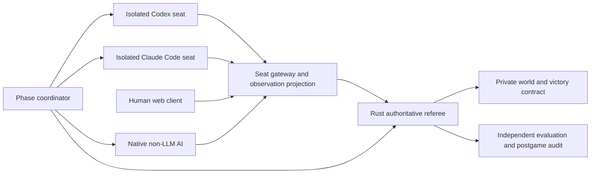

# Native External Agents, Harbor, and Secret Boundaries

Codex and Claude Code must be able to play directly: read observations, use their own shell and files for analysis, keep notes, call game tools, and submit actions without a human intermediary or another LLM translating decisions. A wrapper accepting one prompt and returning final JSON is not complete native integration.

This is an integration specification, not a claim that these tools have been installed or run. Official documentation was checked on November 8, 2026. Implementation must pin CLI, Harbor, and protocol versions. Here “native external agent” means a coding-agent workflow; the separate v1.0 **native non-LLM AI** is a conventional game controller with the same observation/action boundary, described in [chapter 33](../design/33-competition-and-native-ai-v1.0.md).

## Deployment layers

The gateway binds match, seat, phase, and knowledge snapshot. Internal referee interfaces are unreachable from seat networks. HTTP, MCP, and CLI transport the same protocol and must not implement divergent permissions. Model processes may edit their analysis files but cannot modify the referee, server validation, or another seat.

## Native action surface

| Operation | Planned MCP tool | Planned CLI | Meaning |
| --- | --- | --- | --- |
| Observe | `game_observe` | `bts observe --json` | Current seat knowledge snapshot |
| Query | `game_query` | `bts query --request query.json` | Visible entities, rules, objectives, history |
| Submit | `game_submit` | `bts submit --file batch.json` | Original protocol batch and sealed receipt |
| Receipt | `game_receipt` | `bts receipt --key KEY` | Idempotent recovery, never an action redraw |
| Known events | `game_events` | `bts events --cursor CURSOR` | Filtered paginated log |

These are planned project interfaces, not built-in Codex/Claude commands. SDK, CLI, and MCP use identical DTOs. Agents may use HTTP or their own scripts for every legal operation. Client calculators read explicitly supplied observations only, not a free omniscient simulator or future-query service.

The coordinator delivers observations to persistent seat sessions. Within budget, agents may query, program, calculate, and submit a sealed batch. The coordinator enforces deadlines; agents need not occupy a permanently blocking tool. Exit without submission follows timeout rules. Recovery first checks receipts, so crashes grant no extra actions.

Codex supports `codex exec`, JSON event output, and MCP; Claude Code supports `claude -p` and MCP. Prefer their native CLI/tool loops, with lightweight adapters handling startup, recovery, budgets, and archival. Sources: [Codex noninteractive execution](https://developers.openai.com/codex/noninteractive/), [Codex MCP](https://developers.openai.com/codex/mcp/), [Claude programmatic execution](https://code.claude.com/docs/en/headless), and [Claude MCP](https://code.claude.com/docs/en/mcp/).

Record tool calls and environment failures separately for each adapter. Final prose is not an executed action. If CLI differences require different tool capabilities, report separate evaluation configurations rather than silently replacing one with a chat API.

## Seat workspaces

Mount only a generated seat package: current observations, visible rules, public command formats, that seat's history, and writable notes. Complete play requires no game source. Generate `AGENTS.md` or `CLAUDE.md` from equivalent seat templates; do not inherit development conversations, host memories, repository instructions, or third-party plugins.

Each seat has an independent user directory, process, volume, credential scope, and session ID. Notes and sessions persist between rounds of one match. Independent matches use fresh directories and sessions. Adaptive training or cross-match learning must be explicitly enabled and reported separately from first-exploration evaluation.

Do not mount this design repository, complete content templates, authoritative saves, hidden objectives, test answers, private seeds, scorers, the full SDK example library, or other seats' logs. Build images by copying only necessary client files, never copying the whole repository and deleting secrets afterward: old layers, source maps, bundled tests, and help text can still reveal them.

Programming access is not host authority. Provide no host Docker socket, host directory, or management credentials. Server-side API checks remain mandatory; client types, tool allowlists, and prompts are not security boundaries.

## Networks, credentials, and model capabilities

During execution, permit only the seat gateway and model inference proxy. Block general Internet access, public repositories, other seats, and management interfaces, including redirects, proxies, and alternative protocols. The proxy holds provider credentials; seats receive only short-lived match/budget-scoped access.

A provider-domain allowlist alone does not block search, remote files, or hosted tools. Proxy and agent configuration must restrict models, endpoints, and tool parameters and disable Internet retrieval and unauthorized connectors. Seats cannot rewrite this runtime configuration. Preserve shell and local analysis. Preinstall dependencies offline; do not allow package downloads as an indirect source-code channel.

Isolation covers installation/setup, recovery, execution, and scoring, not merely the thinking phase. Cloud CLIs and remote tools require verified execution locations and permissions. Configurations unable to meet these boundaries belong only in nonisolated practice.

## Harbor's role and limits

This means the **Harbor agent evaluation framework**, not a container-image registry. Its documentation covers [tasks](https://docs.harborframework.com/tasks/overview), [pre-integrated agents](https://docs.harborframework.com/agents/pre-integrated-agents), [separate verifiers](https://docs.harborframework.com/tasks/separate-verifier), and [network policies](https://docs.harborframework.com/tasks/network-policies). Evaluate it as a replaceable lifecycle/evaluation wrapper.

Parallel Harbor tasks do not automatically constitute one multiplayer game. An external `MatchCoordinator` maintains one Rust room, phase barriers, and seat resources. Individual Harbor environments host seat processes joining that room through gateways. P0 integration experiments choose custom agent/environment adapters or an outer job driver. Independent trials must not be described as opponents interacting.

Explicitly select a separate verification environment and network policy supported by the backend; “uses Harbor” is not a security claim. Harbor distinguishes environment baselines from agent/verifier overrides, and setup may use the baseline. Therefore formal images are prebuilt and baseline networking is also restricted. Backends lacking enforceable file/network isolation are not approved for formal exploration.

The persistent referee stays outside seat environments. A postgame verifier reads signed logs or referee results and sends scores only to organizers. Secrets must not appear in accessible `/tests`, environment variables, reward JSON, stack traces, or live progress bars. The verifier must not execute arbitrary agent-specified validation code.

Containers or VMs reduce exposure but do not guarantee freedom from vulnerabilities or erase priors. Stronger backends may be appropriate for adversarial testing. Claims must match the actually tested boundary.

## Project tool descriptions as observations

MCP descriptions, CLI help, project templates, rules queries, and schemas are observation surfaces. Use generic `ObjectiveView` and opaque handles. Early protocols must not enumerate FTL tasks or return `ultimate_goal: null`. Opening materials describe present responsibilities and known agendas rather than instruct an agent to pretend ignorance of a named endpoint.

Platform protocols contain generic actions. Content rules arrive through a knowledge-filtered `knowledge_bundle`, extended by versioned events. Known action costs and public resolution semantics must remain clear; secrecy does not justify hiding the meaning of legal actions. Future templates, unknown objectives, and nonexistent handles use equivalent errors.

Culture needs the same strict projection. True tendencies, education/religion response weights, drift speeds, adoption thresholds, and cross-system causal tables remain private. `known_effects`, booleans, errors, help, cache versions, event counts, and historical causal links must not bypass this boundary. Committed costs and acceptance procedures stay public; social responses appear through sourced observation, investigation, or attributed interpretation. An agent inferring patterns is legitimate learning, not a leak to erase.

Training reward, critic state, private demographic functions, contract-liability truth, and unrevealed FTL tests do not enter actor information, tools, logs, or panels. Dataset truncation is not a fabricated game failure. Trained policies may know the endpoint; report their training history.

Native non-LLM AI has no exemption. It receives the same projected knowledge, lacks complete graph access and referee forecasts, and uses a separate policy seed. Easy/Medium/Hard differ in bounded candidate generation, lookahead, uncertainty modeling, and bargaining. All four original civilizations share permissions and resource rules. One to four external seats are supported; native AI fills the remainder. Every official configuration is competitive with one possible winner.

## Isolation acceptance

1. Enumerate files, image layers, environment variables, reachable hosts, and MCP tools from the seat environment. No private manifest or other-seat materials may appear.
2. Compare worlds with identical currently visible state and different hidden endpoints before visible effects occur. Observations, knowledge packages, help, errors, and cursors must match. Normalize independent fixed-length opaque administrative IDs and commitments; they must not encode hidden meaning.
3. Test repeated queries, stale IDs, invalid targets, log lengths, and exceptions for leaks. Fixed scheduling and work budgets mitigate timing channels; do not claim cryptographic constant-time guarantees for an ordinary network service.
4. Verify built-in search, external MCP, subprocesses, and scripts cannot bypass the gateway. Active diplomacy uses only [limited messages](../design/29-diplomacy-communication-v0.8.1.md). All models, processes, and accounts of one seat share three-peer/ten-per-pair accounting; extra MCP, shared files, and outside chat cannot bypass it. Diplomatic text is untrusted game data, never a system instruction, executable code, or automatic tool call. Players may form their own legal decisions from it.
5. Abstract research agendas remain absent before scientific method and emerge from evidence. Endpoint content stays absent before the seat's reveal event. Opponent speculation is not referee certification.
6. Mark opponent prose as untrusted game content. Even if a model follows a malicious suggestion, it can perform only authorized seat actions and cannot gain permissions.
7. Codex, Claude Code, and a non-LLM controller must each complete observation, query, negotiation, submission, and recovery in the same match, demonstrating no hidden human step.
8. Compare identical public population records and behavioral evidence with different private cultural tendencies/learning rates. Until they cause visible effects, observations, packages, preflight, cursors, and summaries remain equivalent. Internal profile updates cannot automatically increment public knowledge versions. Actual behavioral differences may subsequently become observable.
